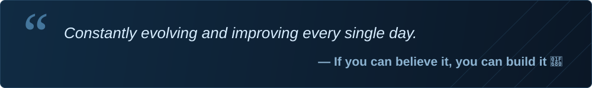

  

  
  

<samp>Writing code. Understanding systems. Always learning.</samp>

 

<h2 align="center">◈ Technologies</h2>

Languages and tools I work with.

  
  
  
  
   
  
  
  
  
  

 

<h2 align="center">◈ About me</h2>

### Hey, I'm DavidM · Abbys

I'm a **developer** interested in how things work, from the logic behind a feature to the interface people use. I work with **Lua, JavaScript, HTML, CSS, Python and MySQL**, and enjoy turning what I learn into practical projects.

**My interests** → Programming, interface design, automation and problem solving.

**Always refining** → Code structure, debugging and performance.

**Hands-on experience** → Community tools and FiveM projects, where I apply scripting and UI development.

 
 

<h2 align="center">◈ Knowledge &amp; skills</h2>

<table>
  <tr>
    <th width="33%" align="left">01 / Programming</th>
    <th width="33%" align="left">02 / Web interfaces</th>
    <th width="33%" align="left">03 / Data &amp; tools</th>
  </tr>
  <tr>
    <td>Lua, JavaScript and Python for scripting, application logic and practical tools.</td>
    <td>HTML and CSS for layout and styling, with JavaScript for interaction.</td>
    <td>MySQL for working with data. Git and GitHub for version control and collaboration.</td>
  </tr>
</table>

 

<h2 align="center">◈ GitHub activity</h2>

  

  
  

 

<h2 align="center">◈ Mindset</h2>

  

DavidM / Abbys &nbsp;·&nbsp; <a href="https://github.com/Carontedev">@Carontedev</a>

